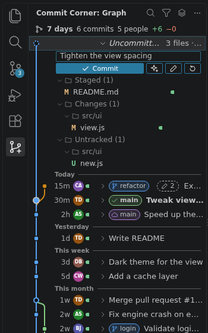
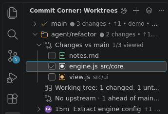
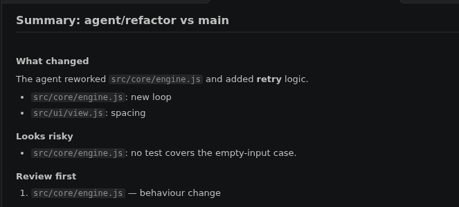

# Commit Corner

**Watch and review what your AI coding agent does — and everything else you do with git.**
A complete Git client for VS Code: a commit graph with a full staging area, worktree
review with *Viewed* checkboxes, pull request diffs, generated commit messages and
change summaries. Plain JavaScript, no runtime dependencies, no telemetry.

<p>
  
  
</p>

### Review an agent's work in three steps
1. **Watch** — the sidebar **Graph** (`Ctrl+Alt+G V`) shows new commits as they arrive
   (they glow for a moment) and a `✎ 2` chip on commits whose worktree has uncommitted
   work.
2. **Review** — in **Worktrees**, the agent's worktree expands to **Changes vs main**:
   everything it changed, committed or not. `Enter` shows a file's diff and keeps the
   keyboard in the list, `Space` ticks it off as *Viewed*; a file the agent changes again
   unticks itself.
3. **Summarize** — the sparkle button on that row (or on a pull request, or selected commits) asks your
   language model what changed, **what looks risky** and which files to read first.



Everything works by keyboard: `Ctrl+Alt+G Space` opens the Actions hub, `?` in the graph
lists its keys. The *Get started with Commit Corner*
walkthrough (Help → Welcome) shows the basics; a short slide deck tours every view (download the
repository and open `docs/intro/index.html` in a browser; it needs internet). **Scope:** GitHub.com for pull requests and web links; everything that is
plain git works with any host.

## Features

### Sidebar: what is going on
The **Commit Corner** sidebar has six views, shown one at a time (switch with the
layers icon in each view's title bar):

| View | What it shows |
|---|---|
| **Graph** (top, `Ctrl+Alt+G V`) | The commit graph, compact and newest first by commit date: every row reads *when* (`7h`, `3d`, `2mo`) │ *who* (avatar) │ *how much* (a green/red change bar) │ *what* (branch badges and message), in fixed columns. Labelled lines split the history into **Today, Yesterday, This week, This month, Older**. Commits that arrived while you were away (since you last hid the view or left the window) get a blue dot. On top, a one-line summary of the last 7 days opens Repository Activity. The view's description says which branches are shown. Title actions: search, choose branches (and Show All), **changes since you last looked** (`Ctrl+Alt+G Shift+V`: the shown branch from where it was then to now, also after a force-push), open the full graph in an editor; Activity and Refresh in the "…" menu. |
| **Repository** | Outgoing/incoming commits, local branches, remote branches, tags and stashes. |
| **Pull Requests** | GitHub pull requests from `refs/pull/*`. |
| **Compare** | Two refs, the working tree, or a pull request against its base. |
| **File History** | The active file's (or folder's, or selected lines') history. |
| **Worktrees** | Every worktree with its uncommitted changes, ahead/behind and age; expands to state, upstream and checked-out commit. The dashboard button opens the Worktrees overview. |

Every commit list in the tree views (File History, branches, Outgoing/Incoming,
Compare, pull request commits) and the pull request list are split into
**Today, Yesterday, This week, This month, Older** like the sidebar Graph
(`commitCorner.timeSeparators`).

The sidebar Graph works like the full one (below): arrows, `Shift`/`Ctrl`
selection, `Enter` opens the changes (several commits: their combined diff),
`Ctrl+C` copies SHAs, `.` / `Shift+F10` the actions, `Ctrl+F` search. It
follows the active repository. **Expand a commit** with its ▸ (or `→`) to see
the files it changed, as a folder tree right under it, each with its status
and a +/− bar; click one (or `→`/`Tab` into the list, `↑`/`↓`, `Enter`) to
open its diff, `←` goes back and collapses. Everything starts collapsed, and
several commits can be open at once. The full graph in the editor expands
commits the same way.

**Staging in the graph.** Expand the *Uncommitted changes* row (in the
sidebar or the editor graph) and it is a complete staging area: a commit
message box (`Enter` commits the staged changes; **Amend** and **Undo Last
Commit** next to it), then Staged / Changes / Untracked (and Merge conflicts)
as folder trees. Each file and group has its buttons on hover or focus —
stage, unstage, discard — and keys: `+` or `S` stages, `-` or `U` unstages,
`Delete` or `D` discards (asking first), on a file or a whole group. `Enter`
opens the file's diff (staged or working-tree side) for line-by-line
staging. The keyboard stays where it was after each action, and the list
follows changes made elsewhere (Source Control, a terminal) while it is open.

**One view at a time.** The sidebar shows one Commit Corner view, filling
it — the Graph by default. **☰ Graph** at the top of the Graph, the **Switch
View** dropdown (the menu icon, first in each view's title bar) and the Actions
hub (`Ctrl+Alt+G Space`) switch to Repository, Pull Requests, Compare, File
History or Worktrees; `Ctrl+Alt+G V` goes back to the Graph. (VS Code shows a
view's title-bar icons only while the mouse is over the view; its setting
`workbench.view.alwaysShowHeaderActions` keeps them visible.) **Collapse All
Commits** in the Graph's title bar (and the editor graph's toolbar) closes every expanded
commit.
VS Code does not let an extension collapse a view, so the others are hidden,
not collapsed. *Sidebar: Show All Views (Stacked)* in the Graph's `…` menu
(setting `commitCorner.sidebar.oneViewAtATime`) stacks all six instead.

### Repository Activity (`Ctrl+Alt+G T`)
"What has been going on" for the last 7 days, 30 days or 12 months, on all
branches or the current one: commits, people, lines and file changes at a
glance; commits per day (per week for a year) as a column chart with
tooltips, keyboard reading (`←`/`→`) and a table view; people ranked by
commits (opens their commits in the graph); the busiest files (opens their
history); merged pull requests (opens them on GitHub); active branches and
new tags (open them in the graph).

### Commit graph (`Ctrl+Alt+G G`)
- Lane-rendered history of all branches, remote branches and tags, virtualized
  for large repositories (paged, 1,000 commits per page).
- Every row shows its **branch and tag badges** with icons (a local branch and
  its remote counterpart share one badge; the current branch shows ↑ahead
  ↓behind), the author with an **initials avatar** (coloured per person,
  generated locally; nothing is downloaded), a **Changes** column with a
  green/red bar and `+added −deleted` lines (loaded for the rows on screen),
  and a compact age (`7h`, `3d`, full date on hover).
- `Ctrl+C` copies the selected commits' SHAs — in the graphs and in every tree
  view (where a file or branch row copies its path or name).
- **Expand a commit** in place (`▸`, or `→`) to look inside it: its files as
  a folder tree under the row, as in the sidebar; the details pane below
  stays for the full message and actions.
- **Any file row** (an expanded commit's, the details pane's, the uncommitted
  ones): `O` or the file button opens the **working file** — at the line you
  were looking at when that revision's diff is open, mapped through the edits
  since, and under its new name when it was renamed; `W` compares it with the
  working file, `B` with the **base branch** (the one you last picked with
  `Shift+B`, else origin's default branch such as `origin/main`, or a local
  `main`/`master`), `Shift+B`
  picks a branch, tag or commit. The right-click
  menu adds Open File at This Revision, Copy Relative Path and Reveal in
  Explorer View.
- **Viewed marks**: a commit's files — and the uncommitted ones — are
  **bold** until you open them, and a commit you started on says how many you
  have seen (`3/12`, ✓ when done). `N` goes to the next bold file and opens it
  (in a diff: *Next Unviewed File*, `Ctrl+Alt+G Shift+N`); `V` or the
  right-click menu's *Mark as Not Viewed* makes an opened file bold again (to
  come back to it later), and a commit's menu marks all of its files. A
  commit's mark belongs to the change, not the commit: when an agent amends or
  rebases, the files whose change stayed the same stay viewed. An uncommitted
  file is bold again as soon as its content changes. Unlike the *Viewed*
  checkboxes of a worktree's or pull request's review lists, which you tick
  yourself, these are set when you open a file. On by default; off with
  `commitCorner.markUnviewedFiles`.
- Uncommitted changes are a row like a commit: its summary, a click opens
  Source Control, `▸`/`→` opens the staging area (see *Staging in the graph*
  above). Folders in expanded file trees collapse and expand (click, or
  `←`/`→`).
- Toolbar: current branch, **Push ↑n** / **Pull ↓n** with counts, Fetch,
  branch filter and search.
- **Multi-select** with `Ctrl`/`Cmd`+click and `Shift`+click (or `Shift`+arrows):
  - **Combined diff**: exactly the changes of the selected commits, also for
    non-contiguous selections: their patches are replayed (renames included)
    onto the oldest one's parent, so unselected commits in between are left
    out. When a selected commit only applies together with an unselected one,
    the diff falls back to "before the oldest ↔ after the newest" per file and
    says so.
  - **Range diff**: everything from the oldest commit's parent to the newest commit.
  - Cherry-pick or revert the whole selection (applied in the right order).
- Details pane: avatar, author, age and date, SHA (copy), change summary,
  full message, committer, signature status (GPG/SSH), parents, refs, and the
  changed files with per-file bars and line stats. Click a file to open its diff.
- Native right-click menus on commits and on branch/tag badges: checkout,
  create branch/tag, cherry-pick, revert, reset, merge, rebase, interactive
  rebase from here, compare, create patch, bisect, copy SHA, open on GitHub.
- **One-click history edits**: squash or fixup a commit into its parent,
  reword it, drop it, squash several selected commits into one, or fold the
  currently staged changes into any older commit (`fixup!` + autosquash).
  These are interactive rebases without the editor; they warn before
  rewriting pushed commits and never drop a commit git would rebase.
- Instant highlight search over loaded commits (message, author, SHA, refs),
  plus server-side search through the whole history by message, author, file
  path or code change (`git log -S`).
- Filter: all branches, local branches, current branch, or any single branch.
- Order: topological (branches stay together) or by date with Today / This week
  / … separators (`commitCorner.graph.order`).
- An "Uncommitted changes" row when the working tree is dirty.

### Source Control (staging and committing)
- Own Source Control provider with **Merge Changes**, **Staged**, **Changes**
  and **Untracked** groups (multi-select works everywhere); stage, unstage,
  discard, add to `.gitignore`, stash selected files, open a whole group in
  the multi-diff editor. Discarded untracked files go to the trash; where
  there is no trash (typical on WSL/remotes) you are asked before they are
  deleted permanently.
- **Line staging** from any editor or diff: stage, unstage or discard the
  selected lines (`Ctrl+Alt+G S` / `U` / `R`), or a whole change from the
  gutter's quick-diff peek. Works on unsaved editor content, handles CRLF
  working trees with LF indexes (`core.autocrlf`) and UTF-8 BOMs, refuses
  non-UTF-8 files, and uses an exact diff (it refuses rather than guesses
  when a file has too many differences). Staged content derived from the
  index is stored byte for byte, so CRLF files are not rewritten by
  `core.autocrlf`. Selections are matched against git's line diff, which
  counts whitespace-only changes that the diff editor hides by default
  (`diffEditor.ignoreTrimWhitespace`): turn that setting off to see exactly
  which lines a selection stages.
- **Edit the index directly**: open the staged side of a diff, edit, save.
  The working tree is not touched.
- Commit, Commit & Push, Commit & Sync, amend (warns if the commit is already
  pushed), sign-off, skip hooks, commit all, allow empty, commit only the
  selected files (from Staged Changes: exactly what is staged, so line
  staging is respected; from Changes: their current content; renames stay
  together), undo last commit (message restored
  to the input box; refused for merge commits), reuse recent messages. Lines
  starting with `#` (issue references) are kept. The input box starts with
  your `commit.template`; squash merges prefill `SQUASH_MSG`.
- Optional protected branches (`commitCorner.protectedBranches`, wildcards
  allowed) ask before you commit to them directly.
- A status limit (`commitCorner.statusLimit`, default 10,000) keeps Source
  Control usable when a build folder is missing from `.gitignore`; refreshes
  back off automatically when `git status` is slow.
- Conflicts: accept ours/theirs (including modify/delete conflicts), open VS
  Code's 3-way merge editor, compare ours ↔ theirs; saving a conflicted file
  without markers offers to mark it resolved (the merge editor's "Complete
  Merge" button is only available to the built-in Git). Stage All never
  stages conflicted files, and line staging refuses them.
- Merge / rebase / cherry-pick / revert in progress: status bar indicator with
  continue, skip and abort. A message you edit before continuing is used.
- Explorer and editor-tab decorations (M/A/D/R/U/conflict, ignored files
  dimmed) and editor-title Open Changes / Stage buttons when the built-in Git
  extension is disabled.

### Tree views
- Commit rows in the Repository (incl. Outgoing/Incoming), Compare, Pull
  Requests and File History views start with the age as a fixed-width column
  (`7h`, `3d`, `2mo`), so it lines up on every row; the icon is the author's
  initials avatar; the description adds `+added −deleted` lines (in File
  History: the lines changed in that file), "merge" for merges, and the author.
  Branch rows start with the age of their newest commit too.
  The list appears at once; the numbers fill in in the background
  (`commitCorner.treeStats` turns them off).
  Their tooltips add the full date, SHA, files changed, refs, the message and
  links: Show Changes, Show in Graph, Copy SHA, Open on GitHub.
- File rows (a commit's, a comparison's, a pull request's) have **Open Working
  File** and **Compare with Working File** inline, and Compare with Base Branch,
  Compare with Branch, Tag or Commit…, Copy Relative Path and Reveal in Explorer
  View in their menu. A commit's files you have not viewed have a dot (●), and
  Mark as Viewed / Mark as Not Viewed in their menu; the commit says `3/12 viewed` once it has been expanded.

### Branches and remotes
- **Repository** view: local branches with ahead/behind and upstream, remote
  branches by remote, tags. Each expands into its commits, which expand into files.
- Checkout (a remote branch creates a tracking branch; dirty working trees get
  "Stash & Checkout"), create, rename, delete (with force for unmerged
  branches), delete on remote, set upstream, merge (ff, no-ff, ff-only,
  squash), rebase, reset (soft/mixed/hard/keep), tags (annotated or
  lightweight, push, delete local and remote).
- **Incoming / Outgoing** commits of the current branch at the top of the view.
- Add, rename, remove remotes and change their URL.
- Fetch, pull, pull with rebase, push (publishes branches without upstream),
  push to any remote/branch,
  force push **with lease**, sync. A rejected push offers "Pull & Push".
  Pull follows your `pull.rebase` / `branch.<name>.rebase` / `pull.ff`
  settings and merges otherwise, so diverged branches never fail with
  "Need to specify how to reconcile divergent branches".
- Push follows git's `push.default` rules: a branch whose upstream has a
  different name (e.g. a feature branch tracking `origin/main`) is never
  pushed there silently — you choose the target, unless `push.default` says
  `upstream` or `current`. Branches created from a remote branch only track it
  when the names match, so a new feature branch never targets `main`.
- Network operations run outside the queue for local writes (a slow fetch
  never blocks staging or committing), show a cancellable notification and
  honour `commitCorner.networkTimeoutSeconds`. Optional auto-fetch.
- **Credential prompts**: HTTPS usernames/passwords/tokens, SSH key
  passphrases and host-key confirmations are asked in VS Code dialogs (a
  dependency-free askpass helper talking to the extension over a private
  socket). Background fetches never show a prompt.
- **GitHub sign-in** (optional, on by default): when git asks for the
  credentials of an HTTPS github.com remote, the GitHub account signed in to
  VS Code (Accounts menu) answers, after a one-time consent. This uses VS
  Code's built-in authentication provider. The same session, once granted, is
  also used for pull request details from the GitHub API. Only network
  commands (fetch, pull, push, clone, …) get the credential helper, never the
  hooks of local commands like commit or rebase. Decline it
  and you are asked for a token as before; turn it off with
  `commitCorner.githubAuthentication`. "Sign In to GitHub (HTTPS Credentials)"
  signs in ahead of time. While you are signed in, Commit Corner answers
  github.com itself and your credential helpers are not used for it (see
  [Security](#security)); decline the sign-in or turn the setting off to keep
  using them.

### Pull requests (GitHub.com)
**Details from the GitHub API** (on by default, `commitCorner.pullRequests.githubApi`):
the list shows each pull request's title, author, last update, state
(open, draft, merged, closed — as icons), base ← head branch and labels, most
recently updated first and split into Today / This week / …; the tooltip adds
the dates and the description (as plain text). Expanding one adds its review
state (approved by / changes requested by) and CI checks (passed, failed,
running) above its commits and files. It uses your VS Code GitHub sign-in when
there is one and never asks for it; public repositories also work signed out.
Private repositories show a "Sign in to GitHub" line until you do. Only
api.github.com is contacted, and unchanged lists are revalidated with ETags.

**Files changed** has a **Viewed** checkbox on each file, as on GitHub
(kept per pull request in this workspace; a push that changes the file
unchecks it), and **Summarize Pull Request** (sparkle button) describes what it does and what
looks risky.

**The diffs always come from git.** GitHub publishes every pull request as
`refs/pull/<n>/head` (and a test merge as `refs/pull/<n>/merge` while it is
open). Without the API (switched off, offline), the view falls back to git only:

- Lists PRs with one `git ls-remote`. Open PRs are recognisable by their merge
  ref; a remote branch at the PR's head is shown as its name. Listing on open
  never asks for credentials (it fails quietly instead).
- Expanding a PR fetches it into a private ref namespace
  (`refs/commit-corner/pr/...`, which keeps your branch lists clean) and shows its
  commits and changed files, **diffed from the merge base like GitHub's
  "Files changed" tab**. The base is the exact commit GitHub's test merge
  used (so a stale local `origin/main` does not matter); without a test
  merge the remote's default branch is fetched along with the PR. The base
  can be changed per PR. Already-merged PRs still show their own changes.
- Open a PR (`Ctrl+Alt+G P`: pick from the listed ones by number, title or
  author, or type a number), check it out as a local branch that
  tracks the PR (Pull brings in new commits; pushing is refused with an offer
  to push to a branch, because GitHub never accepts pushes to `refs/pull/*`),
  show it in the graph or in the Compare view, list open PRs only (the default) or all of them (view menu), remove
  fetched PR refs.
- Works through SSH host aliases for github.com (`git@github-work:org/repo.git`).

- **Create Pull Request…** (Pull Requests view title, a local branch's context
  menu, a branch badge in the graph, the Actions hub, or the offer after
  publishing a branch): picks the base branch (the default branch first) and
  opens github.com's "Open a pull request" page for it. For a fork, the pull
  request goes to the github.com remote called `upstream`. It offers to
  publish the branch, or push unpushed commits, first. A plain link: no API.

In git-only mode there are no titles of unfetched PRs, authors, reviews, CI
status or merged/closed state; after fetching, a PR shows the subject of its
newest commit.

### Compare
- Compare any two branches, tags or commits, or a ref with the working tree
  (`Ctrl+Alt+G C`, or "Select for Compare" then "Compare with Selected").
- **Three-dot** (changes since the branches diverged, what a PR shows) or
  **two-dot** (full difference); swap sides. With the working tree, three-dot
  is the default: everything HEAD did since it left the branch, committed or
  not (e.g. an agent's work against main), without the branch's later commits.
- Commits that name a pull request (`… (#123)`, `Merge pull request #123`)
  link to it in their tooltips, blame hovers and the graph details. SSH host
  aliases for github.com are recognised via `commitCorner.githubHostAliases`.
- Commits only on each side, changed files with stats, open everything in the
  multi-diff editor.
- **Merge preview**: which files would conflict, computed in memory without
  touching your working tree. Exact on git ≥ 2.38; on older git it is
  marked approximate (no rename detection).

### History and blame
- **File History** follows the active editor (or is pinned), follows renames,
  and shows uncommitted changes. Per commit: open the diff, open the file at
  that revision, compare it with the working file, restore it. Select
  revisions to compare two of them, or to see their combined change.
- **Folder history** from the Explorer.
- Commit lists in every view support multi-selection: combined diff, range
  diff, cherry-pick, revert, patch and squash work on the selection.
- **Line History** (`git log -L`) for the selected lines.
- **Current-line blame** after the end of the line plus a status bar item, with
  a hover to show the commit, the file's change in it, or the commit in the graph.
- **File blame** (`Ctrl+Alt+G B`): a gutter column per line block with commit,
  author and date, coloured by age.
- **Blame before this change**: from a blame hover, open the file as it was
  before that commit, blamed again, to dig further back.
- **Previous / next revision** buttons in diff editors to step through a
  file's history.
- Compare the file with any ref or with its previous revision; open the file at
  any revision; reflog browser with actions (create branch, reset, checkout).
- Current-line blame waits for a pause in typing and cancels outdated runs.
- GitHub permalinks for the current selection (copy or open).

### Interactive rebase
- From the graph ("Interactive Rebase from Here") or the command palette:
  reorder by drag & drop or `Alt+↑/↓`, set pick/reword/edit/squash/fixup/drop
  with single keys, write new messages for reworded and squashed commits,
  undo/redo every change (`Ctrl+Z` / `Ctrl+Y`). After any history rewrite
  (rebase, squash, fixup, reword, drop) an **Undo** puts the branch back in one
  step (`git reset --keep`; also "Undo Last History Rewrite" in Actions). No
  editor round-trips: messages are applied by the rebase itself.
- Also opens automatically for `git rebase -i` started in a terminal when
  VS Code is your git editor (`git config --global core.editor "code --wait"`).
  **Start Rebase** runs your plan, **Abort Rebase** (or `Esc`, after asking)
  stops the rebase. Closing the tab without choosing works like closing git's
  own editor: git runs the todo as it is saved (a notice says so).

### Bisect and patches
- Bisect from the graph ("this is good, HEAD is bad") or the command palette;
  mark commits good/bad/skip from the status bar, the graph or the keyboard
  (`Ctrl+Alt+G Shift+G` / `Shift+X` / `Shift+K` while bisecting); the first bad
  commit is reported in a dialog with links to its changes.
- Create patches from commits (`format-patch` series) or from staged/unstaged
  changes (clipboard, file or editor); apply patches as commits (`git am`) or
  to the working tree.

### Repositories
- Initialize or clone a repository, update submodules, several repositories
  per workspace (nested ones included), workspaces opened through symlinks.
- With several repositories, **Switch Repository** is in every view's title
  bar, on the repository name in the editor graph's toolbar and on
  `Ctrl+Alt+G Shift+O`. The repositories you used last come first, each with
  its branch, uncommitted changes and ↑ahead ↓behind; the one you used before
  is preselected, so `Enter` switches back.
- A repository found *above* a workspace folder (a dotfiles repo in `$HOME`)
  is only opened after asking (`commitCorner.openRepositoryInParentFolders`).
  Repositories git refuses for "dubious ownership" get an explanation and the
  `safe.directory` command to trust them.

### Stashes and worktrees
- Stash (with message, include untracked, keep index, staged only), apply,
  pop, drop, create branch from stash, view a stash's changes (including
  untracked files) in the multi-diff editor.
- Worktrees: add (new branch, existing branch, detached), open in a new
  window or this one, add to the workspace, lock/unlock, remove, prune. The
  **Worktrees view** shows each worktree's uncommitted changes, ahead/behind
  and age (looked at again every 10 seconds while visible, so an agent's work
  in another worktree shows up), expands to its state, upstream and
  checked-out commit, and opens its **uncommitted changes** in the multi-diff
  editor (inline button). **Changes vs Base** (inline button, also on the
  overview cards) shows everything a worktree changed since it left the
  default branch — its commits and its uncommitted work in one multi-diff,
  the right side being the files in its folder. `Delete` removes the focused
  worktree.
- **Reviewing an agent's work file by file.** An agent's worktree expands to
  **Changes vs main** (the branch it was created from): every file it changed,
  committed or not, each with a **Viewed** checkbox like GitHub's. Click a
  file to see its diff, tick it off when you have read it (or `Shift+F10` →
  Toggle Viewed); the row counts "5/12 viewed". When the agent changes
  a file again it unchecks itself. Mark All as Viewed / Clear in its menu,
  Summarize (sparkle) and Open All Changes as inline buttons.
- Stashes are a group in the Repository view (`Delete` drops the focused one).
- **Worktrees overview** (`Ctrl+Alt+G W`, or the dashboard button on the
  Worktrees view): one card per worktree with branch, path, staged / changed /
  untracked counts, upstream with ↑ahead ↓behind, the last commit (avatar,
  author, age) and buttons to open, add to the workspace, show in the graph,
  lock or remove it. Arrow keys move between cards, `Enter` opens, `Delete`
  removes.

### Generated commit messages and summaries (language models)
With a language model provider installed and signed in (GitHub Copilot Chat,
or another extension that provides models; VS Code asks once whether Commit
Corner may use it):

- **Generate Commit Message** — the sparkle button next to Commit in the graph's
  commit box (and in Source Control's title bar when it shows Commit Corner's
  changes) — writes a commit message for what Commit would commit — the staged
  changes, or all of them when nothing is staged — in the style of your recent
  commits. You see it being written; the button turns into Stop (or `Escape`).
  It works the same with the built-in Git switched off.
- **Summarize** a worktree's Changes vs Base, a pull request, or the commits
  selected in the graph (context menu): what changed, **what looks risky**, and
  which files to review first, on a page you can copy from.

Only what you ask about is sent, and only when you ask: the diff (new,
untracked files included), file names, and for commits their messages,
authors and dates; for a commit message also the branch name and your last 10
commit subjects. Files that may hold secrets (`.env`, keys, credentials…) go by
name only, and known token formats and `password=…`-style values are removed —
best effort, not a guarantee. The summary page says how much was left out.
Files ignored by `.gitignore` are not part of a summary or of Changes vs Base (an
agent could hide work there: look at what it ignored). A
summary is written from the changes, so text in them can steer it: read the
diff for what matters. Turn it all off with `commitCorner.ai.enabled`; pick a
model with **Commit Corner: Choose Language Model…** or `commitCorner.ai.modelFamily`
(family, id or name; both user settings only).

When an answer is empty or a model fails, the summary page (or the notification) says
so and offers *Choose Model…* and *Show Log*. Output → *Commit Corner* names the model
chosen, what was sent and how the model answered (lines starting with `AI`); set its
log level to Debug (the gear on the Output panel, or **Developer: Set Log Level…**) to
see the answers too, or Trace for the requests as sent. Copilot CLI's models are
skipped: they answer other extensions with nothing.

## Scope and privacy

> **GitHub.com only** for pull requests, web links and permalinks. Other hosts (GitLab,
> Bitbucket, GitHub Enterprise, self-hosted forges) are deliberately not supported; their
> repositories still work for everything that is plain git (staging, history, graph,
> branches, compare, blame, rebase, stashes, worktrees).

A full git client for VS Code, written as plain JavaScript with **zero runtime
dependencies**: the extension ships no npm packages, no bundler output and no
telemetry, and makes no network access other than the git commands you run
(fetch, pull, push, `ls-remote` for pull requests), VS Code's own GitHub
sign-in if you allow it, and — an explicit exception — the GitHub REST API for
pull request details (titles, authors, state, reviews, checks; switch off with
`commitCorner.pullRequests.githubApi`); generated messages and summaries go through
VS Code's Language Model API to the model provider you installed, only when you ask (see
*Generated commit messages and summaries*). Development tooling (tests in a real VS Code,
packaging) uses a few dev-only npm packages; see [Development](#development).

Diffs open in VS Code's own diff editors, so syntax highlighting, language
features, inline/side-by-side view and word-level diffs all work as usual.

## Install

Commit Corner is not on the Marketplace. Install it in three steps:

1. **Download** `commit-corner-<version>.vsix` and `SHA256SUMS` from the
   [latest release](https://github.com/t0mdev/commit-corner/releases/latest) into one folder.
2. **Check** the download in that folder:

   ```sh
   sha256sum -c SHA256SUMS          # Linux; must print: commit-corner-<version>.vsix: OK
   shasum -a 256 -c SHA256SUMS      # macOS
   ```

   On Windows (PowerShell) this must print `True`:
   `(Get-FileHash commit-corner-<version>.vsix).Hash -eq (Get-Content SHA256SUMS).Split()[0]`
3. **Install**: in VS Code, Extensions view → `…` → *Install from VSIX…*, or from a
   terminal `code --install-extension commit-corner-<version>.vsix` (on macOS, first run
   *Shell Command: Install 'code' command in PATH* from the Command Palette).

Updates are not automatic: install a newer `.vsix` the same way.

**Requirements:** VS Code 1.140 or newer and git 2.27 or newer. Pull requests and web
links need a GitHub.com remote; everything else works with any git host.

### Build it yourself

No build step. Package with VS Code's packaging tool and install:

```sh
npm ci                                       # dev tooling only (see Development)
npm run package                              # vsce package -> commit-corner-<version>.vsix
code --install-extension commit-corner-*.vsix
```

or link the folder for development:

```sh
ln -s "$PWD" ~/.vscode-server/extensions/t0mdev.commit-corner-dev   # WSL / remote
ln -s "$PWD" ~/.vscode/extensions/t0mdev.commit-corner-dev          # local
```

Then reload the window. The extension runs where your files are
(`extensionKind: workspace`), so in WSL or SSH remotes it runs on the remote.

## Coexisting with the built-in Git extension

Both can run together. *Use Commit Corner Only (Turn Off Built-in Git)…* (a command,
also offered in the *Get started* walkthrough) sets `"git.enabled": false`; set it back
to `true` to undo. To avoid duplicate gutter markers, badges, Explorer
decorations and status bar items, Commit Corner's `quickDiff`, `countBadge`,
`explorerDecorations` and `statusBar` settings default to `auto`: they switch
on only when the built-in extension is disabled (`"git.enabled": false`). Set
them to `always` to force them on.

Things to know before disabling the built-in Git:

- Other extensions that use the built-in Git API (GitHub Pull Requests,
  Copilot's commit-message generation, …) stop seeing your repositories.
- The Timeline view's git entries come from the built-in extension; the
  Timeline API is not available to other extensions. Use File History instead.
- VS Code's merge editor has no "Complete Merge" button for third-party
  providers; stage the file (the inline ✓) when you are done.

## Keyboard shortcuts

Everything works without a mouse (layout: English/US). All shortcuts start
with the chord `Ctrl+Alt+G` (`Cmd+Alt+G` on macOS); the second key also works
with `Ctrl+Alt` still held (`Ctrl+Alt+G Ctrl+Alt+S`, `Ctrl+Alt+G Ctrl+Alt+Shift+P`).

| Then | Action |
|---|---|
| `Space` | **Actions…**: in-progress operation first, then every view and the main actions, with their shortcuts |
| `G` | Show graph |
| `H` / `L` | File history / line history of the selection |
| `B` | Toggle file blame |
| `I` / `Shift+B` | Show the commit of the current line / blame before that change |
| `S` / `U` / `R` | Stage / unstage / discard selected lines |
| `Shift+S` / `Shift+R` | Stage / discard the whole change (hunk) at the cursor |
| `A` / `Shift+A` | Stage / unstage the current file (also from the staged side of a diff); not while a list or tree has focus |
| `D` | Open the changes of the current file (not while a list or tree has focus) |
| `←` / `→` | Previous / next revision of the file in a diff |
| `Enter` | Commit |
| `F` / `Y` | Fetch / sync |
| `Shift+P` / `Shift+F` | Push / pull |
| `Shift+G` / `Shift+X` / `Shift+K` | Bisect: mark good / bad / skip (only while bisecting) |
| `C` | Compare refs |
| `O` | Checkout |
| `P` | Open a pull request (pick one, or type its number) |
| `Shift+U` | Undo the last history rewrite (rebase, fold, reword…) |
| `W` | Worktrees overview |
| `V` / `Shift+V` | Focus the sidebar Graph / changes since you last looked |
| `T` | Repository Activity |
| `Z` / `Shift+Z` | Stash / pop a stash |
| `N` | Create pull request |
| `Shift+N` | Next unviewed file of the commit (in a diff opened from a commit's files) |
| `Shift+W` | Open the working file at the same line (in a revision or diff) |
| `Shift+O` | Switch repository (several open) |

**Graph** (focused when it opens; `?` shows this list):
- `↑ ↓ PgUp PgDn Home End` move; `Shift` extends the selection; `Ctrl+↑/↓`
  moves without selecting and `Ctrl+Space` toggles a commit (non-adjacent
  selections); `Space` selects only the commit at the cursor; `Ctrl+A` selects
  all; moving past the last row loads more. After a reload (reword, squash, …)
  the cursor keeps its place.
- `Enter` opens the selected commit(s); `Shift+F10` / Menu key opens the same
  context menu as a right-click, next to the cursor row; `.` opens those
  actions (including the branches and tags at the commit) as a searchable
  list. Both act on the selection when the cursor is inside it, otherwise on
  the cursor's commit alone. `Ctrl+C` copies SHAs.
- `Ctrl+F` searches (mode "Go to SHA / ref" jumps anywhere in the history);
  `↓` or `Esc` goes from the search box to the results; `Esc` in the list
  clears the search.
- On a file: `Enter` opens its diff, `Space` previews it, `O` opens the
  working file, `W` / `B` / `Shift+B` compare it with the working file / the
  base branch / a branch, tag or commit you pick, `N` goes to the next unviewed file, `V`
  toggles its viewed mark.
- `Tab` moves into the details pane (`↑`/`↓` between files, `Enter` opens,
  parent SHAs are buttons, `Esc` anywhere in it returns to the list); focus
  stays in the pane when it refreshes.

**Interactive rebase editor:** `↑`/`↓`, `PgUp`/`PgDn`, `Home`/`End` between
commits (exec/break lines are skipped), `P R E S F D` set the action (`R` puts
the cursor in the new message), `Alt+↑/↓` reorder, `Tab` reaches the row's
action list and message box, `Enter` shows the commit, `Ctrl+Enter` starts.
`Esc` leaves a message box; on a row it cancels (asking first when the plan
was changed) or, for a `git rebase -i` from the terminal, aborts after asking.
`Ctrl+Z` / `Ctrl+Y` (or `Ctrl+Shift+Z`) undo and redo changes to the plan
(order, actions, messages); inside a message box they edit its text.

Tree views, Source Control, quick picks and diff editors are VS Code's own, so
their keyboard navigation applies; Source Control group actions (open all,
stage all, discard all) are also in the group's context menu (`Shift+F10`).
In the Repository and Worktrees views, `Delete` deletes, drops or
removes the focused item (after confirming) and `F2` renames a branch or
remote. The global chords act on the active editor; the ones that change a
file (`A`, `Shift+A`, `D`) are off while a list or tree has focus, so they
never hit a different file than the one you are looking at.

## Settings

All settings live under `commitCorner.*`; see the Settings UI for
descriptions. The main ones are `smartCommit`, `pullRebase`,
`autoFetchMinutes`, `dateFormat`, `fileLayout`, `markUnviewedFiles`, `graph.pageSize`,
`graph.showChanges`, `treeStats`, `avatars`, `githubAuthentication`,
`refreshWhenUnfocused` (views keep up, throttled, while VS Code is in the
background, e.g. while an agent works in a terminal), `blame.currentLine` and
`gitPath`; `writeCommitGraph` writes git's commit-graph file once in the
background for a large history that has none (skipped where `core.commitGraph`
or `gc.writeCommitGraph` is false). The Settings UI groups them: General, Source Control, Branches and
Remotes, Graph, Views, Pull Requests, Blame.

## Security

- Git runs without a shell (arguments are passed as an array), with
  `GIT_TERMINAL_PROMPT=0` so nothing can hang on a terminal prompt.
- Your hooks run with your environment: paths are marked literal per
  argument (`:(literal)`) and only git's message language is forced to
  English, instead of global variables that would leak into hooks.
- Ref names that look like options (a tag called `--output=/some/file` can
  arrive with a normal fetch) are passed by their full name, and the git layer
  refuses any revision starting with `-`.
- Credentials embedded in remote URLs are redacted from the log.
- Reads run with `GIT_OPTIONAL_LOCKS=0`, so background views never take
  `index.lock` away from your terminal.
- Webviews use a strict Content Security Policy (nonce-only scripts, no remote
  content), and all repository data is inserted with DOM text APIs, never as HTML.
- Untrusted workspaces are not supported: git can run hooks and configured
  programs from a repository, so the extension stays off until you trust the folder.
- A repository is only opened through its own `.git` (folder, or a `.git` file
  of a linked worktree or submodule). A bare repository committed inside a
  clone, whose config could name programs (`core.fsmonitor`), is refused, and
  git runs with `safe.bareRepository=explicit` (git 2.38+).
- The interactive-rebase editor for `git-rebase-todo` files never opens a
  repository by itself; it shows commit details only for repositories that
  are already open.
- Repository text in notifications (file names, commit subjects, git's and
  the server's messages) cannot form clickable links; `$(icon)` syntax in
  names is shown literally in the status bar and pickers.
- Credential prompts: each network command gets its own askpass token,
  revoked when it exits; the GitHub session answers only git's own
  `https://github.com` prompts, never ssh's (a server chooses those texts).
  Hooks run by a push or fetch run as you and can reach the prompt channel
  while that command runs. While you are signed in, git's credential helpers
  are switched off for `https://github.com` in network commands, so none of
  them (e.g. `credential.helper=store`) writes the session token to disk; the
  token is only given to commands started that way (signing in while a push
  waits does not hand it to that push). ssh prompts are labelled as the
  server's ("the SSH server asks").
- git never inherits `GIT_DIR`, `GIT_WORK_TREE`, `GIT_INDEX_FILE` or similar
  variables from VS Code's environment.
- Remote names are checked before they reach git (a "remote" called
  `--upload-pack=…` is refused), and webview pages can only name a commit or a
  pull request number when they ask for a command — never a remote or repository.
- The settings that decide which repositories open
  (`detectRepositoriesOfOpenFiles`, `openRepositoryInParentFolders`) and
  `githubHostAliases` can only be set in user (or remote) settings, not by a
  repository's `.vscode/settings.json`.

## Repositories outside the workspace

Opening a file from outside the workspace folders does not make Commit
Corner run git in its repository right away: git runs programs that a
repository's own configuration names (fsmonitor, filters, …), so it asks
first and remembers your answer per repository
(`commitCorner.detectRepositoriesOfOpenFiles`: prompt, always, never). Diff
tabs of repositories that are not open stay empty instead of opening them.

## Development

```
src/git/       pure git layer (no VS Code): runner, parsers, repository ops,
               graph layout, line diff, multi-commit combination, rebase todo
src/vscode/    VS Code integration: SCM provider, views, commands, blame,
               file system provider for git revisions, webview hosts
media/         webview scripts and styles (vanilla JS/CSS), icons
scripts/       check.js, sequence-editor.js and askpass-main.js (run by git)
test/          node:test unit/integration suites (real repositories; a vscode
               API mock runs the extension layer)
test/integration/  mocha suites that run inside a real VS Code
test/ui/       the webviews' DOM in a real VS Code, driven over the DevTools protocol
```

```sh
npm ci                  # install the pinned dev tooling (needs the npm registry)
npm test                # unit tests, then the real-VS-Code suites
npm run test:unit       # node:test only (no network, no VS Code)
npm run test:vscode     # real VS Code: 1.140.0 (minimum), latest stable, 1.140.0
                        # with the built-in Git switched off (replacement mode), and
                        # the webview UI tests in 1.143.0
npm run test:vscode:min # only the pinned 1.140.0 run (offline once downloaded)
npm run test:ui         # only the webview UI tests (VS Code 1.143.0)
npm run check           # syntax check + manifest consistency
npm run audit           # npm audit, fails on moderate or worse
npm run package         # vsce package
```

**Policy: runtime vs. development dependencies.** The extension itself has no
dependencies; its only own network calls are the optional GitHub API requests
for pull request details (see [docs/DEVELOPMENT.md](docs/DEVELOPMENT.md)). By
design, development follows VS Code's official guides,
which needs a few dev-only packages and network access:

- **Testing** follows [Testing Extensions](https://code.visualstudio.com/api/working-with-extensions/testing-extension):
  `@vscode/test-cli` + `@vscode/test-electron` download VS Code builds into
  `.vscode-test/` (git-ignored) and run `test/integration` inside them.
- **Packaging** follows [Publishing Extensions](https://code.visualstudio.com/api/working-with-extensions/publishing-extension):
  `@vscode/vsce` with `.vscodeignore`; dev dependencies never enter the .vsix.
- Other practices from the [Extension API docs](https://code.visualstudio.com/api)
  (UX guidelines for views, webviews and notifications; webview security,
  theming and persistence) are followed in the code.
- **Supply chain**: every package version (including transitive ones) must be
  at least **4 weeks old**; `.npmrc` enforces it with `before=<date>`, which is
  raised deliberately and never to less than 4 weeks ago. Versions are exact
  (`save-exact`) and locked (`package-lock.json`). Run `npm audit` after every
  install; `overrides` pin patched versions of vulnerable sub-dependencies.
  Details and accepted findings: [docs/DEVELOPMENT.md](docs/DEVELOPMENT.md).

Tests that need a human eye are in `docs/SMOKE_TEST.md`.

Requires git ≥ 2.27. A few features use newer git when available:
`merge-tree --write-tree` (2.38) for merge previews (older versions use the
legacy merge-tree output), and `stash --staged` (2.35).

## Support and contributions

Commit Corner is a free hobby project, provided **as is** (see [LICENSE](LICENSE)): there
is no guaranteed support and no promised time for fixes. Issues and pull requests are
welcome; contributions are accepted under the project's MIT License. In a bug report,
please include the Commit Corner, VS Code, git and OS versions and the relevant lines from
Output → *Commit Corner* (its first line names the versions). Lines at the Info level are
enough (they can name your folders' paths); Debug and Trace lines contain your changes and
the language model's answers about them. Please report security problems privately, as described in
[SECURITY.md](SECURITY.md).

## License and trademarks

[MIT](LICENSE). Commit Corner is an independent project, not affiliated with or endorsed by
the Git project, GitHub or Microsoft. Git and the Git logo are trademarks of Software
Freedom Conservancy, Inc., corporate home of the Git Project. GitHub, GitHub Copilot and
Visual Studio Code are trademarks of GitHub, Inc. or Microsoft Corporation.
